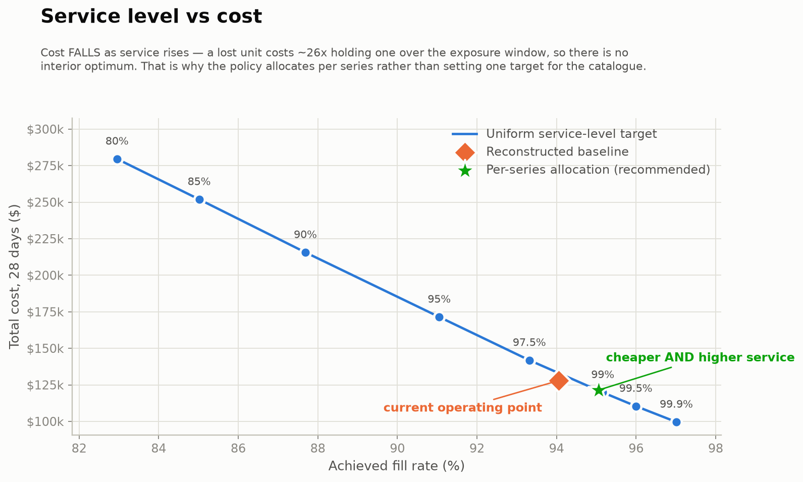

# Supply Chain Intelligence

> **Cuts simulated inventory cost 5.0% while raising fill rate 1.0 point, across
> 30,490 retail SKU-store series** — by choosing a service level per series
> rather than one target for the whole catalogue.
>
> 95% bootstrap CI on the cost delta: −8.5% to −1.9%.
> The baseline is *reconstructed*, not observed — [read why that matters](docs/03-assumptions-and-limitations.md#a5--the-observed-baseline-is-reconstructed-not-observed).

**Live demo:** _not yet hosted. `docker compose up --build` runs it locally —
dashboard on :8501, API docs on :8000/docs. Verified working._

---

## The business problem

A retailer holds inventory at thousands of store-SKU combinations. Hold too much
and capital sits on shelves; hold too little and sales are lost. The decision is
how much to stock at each store-SKU, and at what service level.

This project answers that end to end: it forecasts demand as a **distribution**,
converts those distributions into a replenishment policy, and simulates that
policy against reconstructed observed behaviour to put a defended cost number on
the difference.

The deliverable is not a forecast. It is a replenishment decision with a cost
attached and its assumptions written down.

## Architecture

```
sources/     M5 (Kaggle), Open-Meteo, FRED
   |
ingest/      idempotent, checksummed pulls -> parquet
   |
warehouse/   DuckDB star schema  (59.2M rows)
   |
transform/   availability filter, stockout proxy, segmentation  (46.9M-row panel)
   |
features/    point-in-time-correct feature store  (33 features, every lag >= 28d)
   |
models/      baselines -> global LightGBM -> quantiles -> calibration
   |             + AutoETS/TSB on aggregates -> MinT reconciliation (42,840 nodes)
   |
optimize/    (s,S) policy, expected-cost allocation, constrained LP + shadow prices
   |
app/         FastAPI + Streamlit
```

## Results

Test window d1914–1941, scored once. Full detail in [docs/04-results.md](docs/04-results.md).

### The decision

| Policy | Fill rate | Cost (28d) | vs baseline | 95% CI |
|---|---:|---:|---:|---|
| Reconstructed baseline | 94.05% | $127,930 | — | — |
| Better forecast only | 94.03% | $129,254 | +1.0% | −1.3% to +3.5% |
| Empirical safety stock, uniform level | 94.02% | $133,976 | +4.7% | +1.4% to +8.3% |
| **Per-series cost-optimal allocation** | **95.06%** | **$121,500** | **−5.0%** | **−8.5% to −1.9%** |

The recommended policy is cheaper **and** serves more demand — dominance, not a
trade-off.

**The decomposition is the interesting part.** A better forecast alone bought
nothing (CI spans zero). Replacing normal safety stock with an empirical
bootstrap at a uniform service level was actively *worse*. The entire gain came
from **deciding which series deserve the stock** — the allocation step. That is
not the result the project was hoping for, and it is the one it found.



The star is the recommendation and the diamond is where the business currently
sits: down and to the right means cheaper *and* better served, so there is no
trade-off to argue about. The blue curve is what a single uniform target buys —
the recommendation is not on it, because it sets a different service level for
each series.

### The forecast

| Model | CV WRMSSE | Test WRMSSE |
|---|---:|---:|
| **Global LightGBM (Tweedie)** | **0.8559** | **0.8446** |
| TSB | 0.8893 | 0.8626 |
| Croston | 0.8910 | 0.8639 |
| Moving average | 0.8950 | 0.8720 |
| Seasonal naive | 1.1563 | 1.1017 |
| Zero forecast | 1.3963 | 1.4132 |

A 3.8% CV improvement over a tuned TSB baseline. Modest, and reported as such —
the direct 28-day-lag design gives up short-horizon accuracy in exchange for a
leakage audit that is arithmetic rather than trust.

Quantiles calibrate almost exactly where the optimizer reads them. On the locked
test fold, nominal 0.90 covers **0.9007**, nominal 0.95 covers **0.9505**, and
nominal 0.99 covers **0.9885** — gaps under 0.002. That matters more than the
WRMSSE: a 0.95 quantile that only covered 0.88 would make the optimizer buy a
service level it never achieves in the store.

### Hierarchical coherence

Independent forecasts at different altitudes disagree by **8.1%** — the
total-level forecast says 1,147,983 units while the bottom level sums to
1,241,178. Two teams, same 28 days, two plans.

Reconciliation over all **42,840 nodes across 12 levels** fixes that exactly
(adding-up violation 7,934 units → 0). `wls_var` MinT also improves the bottom
level 0.8% for free, purely from pooling information across levels.

But the honest headline is the other way round: **bottom-up beats every MinT
variant on the aggregate levels** — 55% better at total. That is a fact about
these base forecasts, not about reconciliation: the bottom model is tuned and
backtested while the aggregate models are an out-of-the-box AutoETS. MinT blends
toward the weaker forecast. [Full table and what it implies →](docs/04-results.md#10-hierarchical-reconciliation)

The solve is matrix-free: `S'W⁻¹S` is 30,490² **and dense**, needing ~7.4 GB on
a 7.3 GB machine, so conjugate gradients uses only its action on a vector — two
sparse mat-vecs over 365,880 non-zeros. Verified against the dense closed form
on a small hierarchy.

### The data work

- **46,881,677-row panel** from 59.2M raw rows. The 20.8% dropped are SKU-store
  pairs the store did not carry yet — verified, not assumed: the price-NULL block
  is contiguous and leading for **100.00%** of all 30,490 series, and no row
  anywhere has positive sales with a NULL price.
- **91% of series are intermittent or lumpy** (Syntetos-Boylan). ETS and ARIMA
  are the wrong family for nearly the whole catalogue.
- **45% of revenue sits in the AZ box** — high value *and* highly erratic. This
  is the direct argument for forecasting the distribution rather than the mean.
- **3.99% of panel days are likely stockouts**, found with a per-series adaptive
  threshold rather than a fixed rule.
- **SNAP days lift FOODS +7.7%** but HOBBIES only +1.3% — an end-to-end
  validation of the calendar → store → state join that nothing was tuned to produce.

## Documentation

| Doc | What is in it |
|---|---|
| [01-data-sources.md](docs/01-data-sources.md) | The four sources, the unpivot, provenance |
| [02-methodology.md](docs/02-methodology.md) | Protocol, model ladder, leakage rules, policy derivation, LP formulation |
| [03-assumptions-and-limitations.md](docs/03-assumptions-and-limitations.md) | Ten numbered assumptions, each with its direction of bias |
| [04-results.md](docs/04-results.md) | Every measured number, reproducible |
| [05-deployment.md](docs/05-deployment.md) | Local + Fly.io, and the gitignore gotcha that decides the host |
| [06-resume-and-interview.md](docs/06-resume-and-interview.md) | Resume bullets with real numbers, and cold answers to the hard questions |

## Limitations

[docs/03-assumptions-and-limitations.md](docs/03-assumptions-and-limitations.md).
**Read it before the results table.** Ten numbered assumptions, each with its
direction of bias. The load-bearing ones:

- The baseline is reconstructed. M5 has no inventory data at all.
- Every cost parameter is assumed. The holding-to-stockout ratio (~1:26 over the
  exposure window) drives the entire answer.
- The counterfactual replays realised demand, which was itself shaped by the
  stockouts the real stores had. It therefore *understates* what a better policy
  would achieve.

## Things that went wrong, and were fixed

Written up rather than quietly patched — they are the most useful part of the
repo:

1. **The stockout rule flagged 18.3% of the panel** with a mean run of 40 days.
   That is dormancy, not stockout. Cause: a lifetime demand rate cannot see
   drift. Fixed with a trailing 56-day local rate → 3.99%, median run 8 days.
2. **The alpha sensitivity table was inert** — it recomputed thresholds over the
   already-filtered table, so every alpha above the build value returned the same
   answer. The real range is 2.37%–10.86%.
3. **The first cost comparison was rigged** — policies ran at different achieved
   service levels, so the "32% more expensive" result was measuring the service
   gap. Fixed by bisecting every policy onto the same fill rate.
4. **The first allocation overfit** — it chose each series' level by simulating on
   the realised test demand. A 39% "saving" that was hindsight. Levels now come
   from forecast-derived expected cost only.
5. **AutoETS was run on all 12,350 aggregate nodes.** It took over 20 minutes and
   drove the machine into swap — for the `item` and `item × state` levels, which
   are *still intermittent* and where a smoothing model has least to offer. Now
   routed: AutoETS on the 154 genuinely smooth nodes, TSB on the 12,196 sparse
   ones. Runs in seconds.
6. **The dashboard rendered a blank executive view** after a policy rename, because
   it filtered for a name that no longer existed. Caught by `tests/test_dashboard.py`,
   which runs every view through Streamlit's `AppTest`.

## How to run locally

```bash
uv sync --extra dev --extra models --extra optimize --extra app
cp .env.example .env      # set SCI_DATA_DIR and SCI_M5_SOURCE

uv run sci ingest all              # M5 from local zip + Open-Meteo weather
uv run sci warehouse build         # ~4 min -> 163 MB DuckDB
uv run sci analyze                 # the five SQL analytics reports

uv run python scripts/run_model_ladder.py     # ~40 min
uv run python scripts/run_optimizer.py        # ~15 min
uv run python scripts/run_reconciliation.py   # ~2 min
uv run python scripts/build_serving_bundle.py
uv run python scripts/make_figures.py    # regenerates docs/frontier.png

uv run streamlit run app/dashboard.py
uv run uvicorn app.api:app --reload
```

Or containerised:

```bash
uv run python scripts/stage_deploy.py   # copies 23 MB of serving artifacts into the build context
docker compose up --build               # dashboard :8501, API :8000/docs
```

**Verified.** Built and run on Docker 29.7.2 / Compose v5.5.1. Both containers
report healthy; `/simulate` runs the full 30,490-series simulation inside the
container in ~42 s and returns numbers identical to the local run. Image is
1.4 GB; the API holds ~209 MB resident, the dashboard ~76 MB.

Requires Python 3.11 or 3.12 and the M5 dataset from
[Kaggle](https://www.kaggle.com/competitions/m5-forecasting-accuracy/data)
(accept the competition rules first). Set `SCI_DATA_DIR` somewhere outside any
synced folder — the warehouse and matrices run to several GB.

Tests: `uv run pytest` (123 tests).
